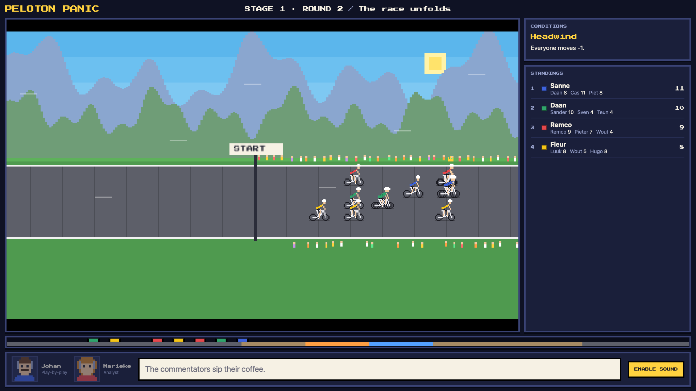
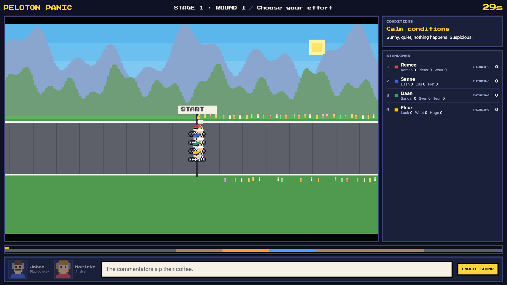
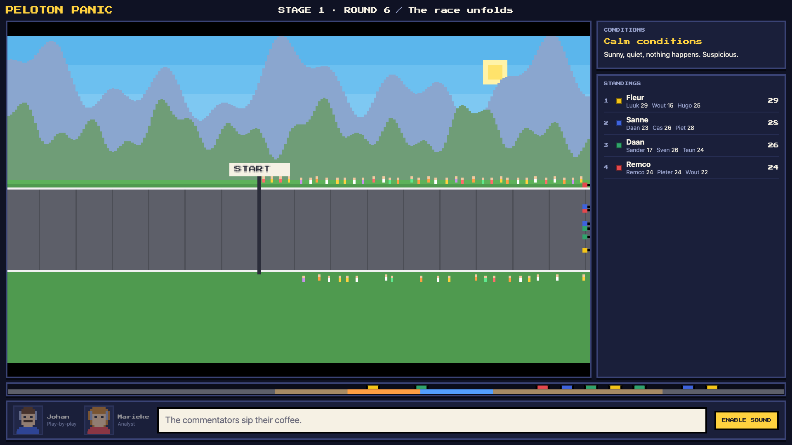
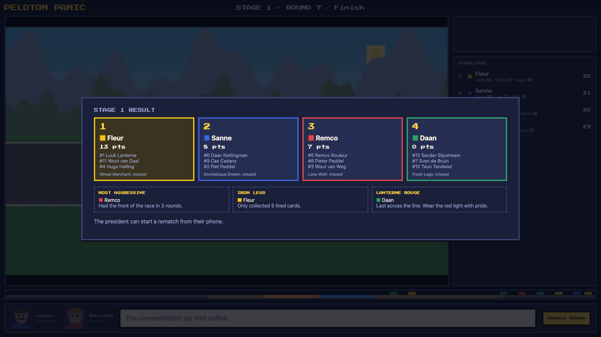
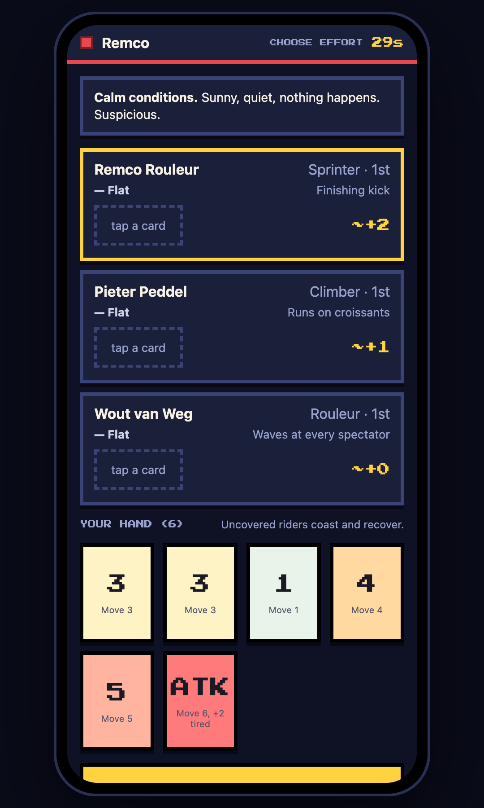
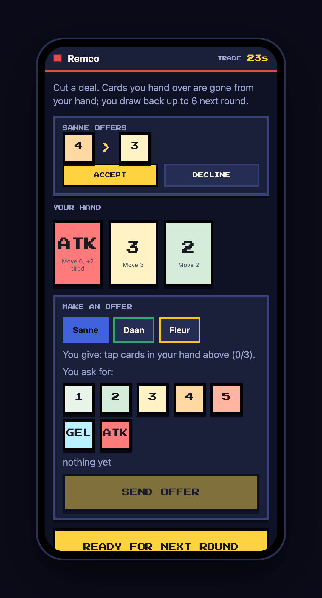
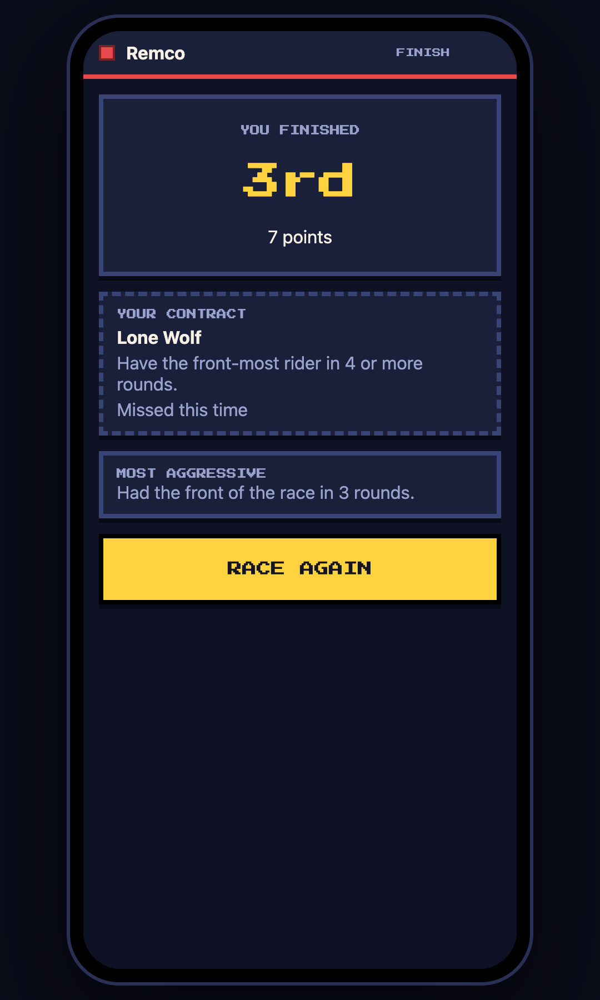

# Peloton Panic

A couch board game. The TV is the table, phones are the hand. Manage a three-rider cycling
team, sneak cards past your friends, trade favours in the bunch, and try not to finish
under the red lantern.



## Run it

```bash
npm install
npm run setup:tts   # optional: installs rany2/edge-tts into ./.venv for commentator voices
npm run dev
```

- TV: open <http://localhost:3000> on the computer or TV browser.
- Phones: scan the QR code on the TV, or open the address shown under the room code.
  Phones must be on the same Wi-Fi as the computer running the server.
- The first player to join is the **president** and gets the Start button. Use `+ BOT` to
  fill the peloton, or to try the game alone.

## How a round works

1. **Event**: the TV reveals conditions (wind, rain, a chicken on the road...).
2. **Choose effort**: everyone secretly plays one card per rider from their shared hand.
   Riders without a card coast and recover a tired card.
3. **Resolve**: all moves happen at once. Followers draft (+1), the front of each group
   pays a tired card into the wind. Dropped riders get pulled back by the peloton.
4. **Trade**: open table talk. Offer cards, ask for cards, make pacts.
5. Repeat until someone crosses the line. Top six riders score; secret sponsor contracts
   add bonus points; last place wins the **Lanterne Rouge**.

## Commentators

Two pixel-art commentators narrate from the game log. Voices come from Microsoft Edge's
online voices through [edge-tts](https://github.com/rany2/edge-tts), synthesised on the
server and cached in `.cache/tts`. Without it the game falls back to browser speech and
then to captions only. Browsers need one click or key press on the TV to allow sound.

Edge TTS is an unofficial client of a Microsoft service: fine for a home game, but not
something to depend on for a public product. Voices live in `src/shared/content.ts`.

## Project layout

```
src/shared/   rules engine (pure reducer), content, commentary, protocol
src/server/   rooms, WebSocket server, bots, TTS
src/client/   tv/ (canvas track + HUD) and play/ (phone controller)
scripts/      setup-tts.sh, screenshots.mts
```

The rules are `(state, action) -> state` in `src/shared/engine.ts`, so the whole game is
deterministic from a seed and covered by `npm test`.

## Commands

| Command | What it does |
| --- | --- |
| `npm run dev` | Server plus Vite dev middleware on :3000 |
| `npm test` | Rules engine tests |
| `npm run typecheck` | TypeScript check |
| `npm run build` / `npm start` | Production build and server |
| `npm run screenshots` | Plays a bot game against the dev server and saves `docs/screenshots` (needs Google Chrome) |

## Screenshots

| | |
|---|---|
|  |  |
|  |  |

<p>



</p>
