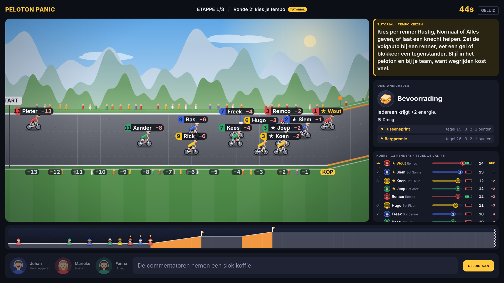
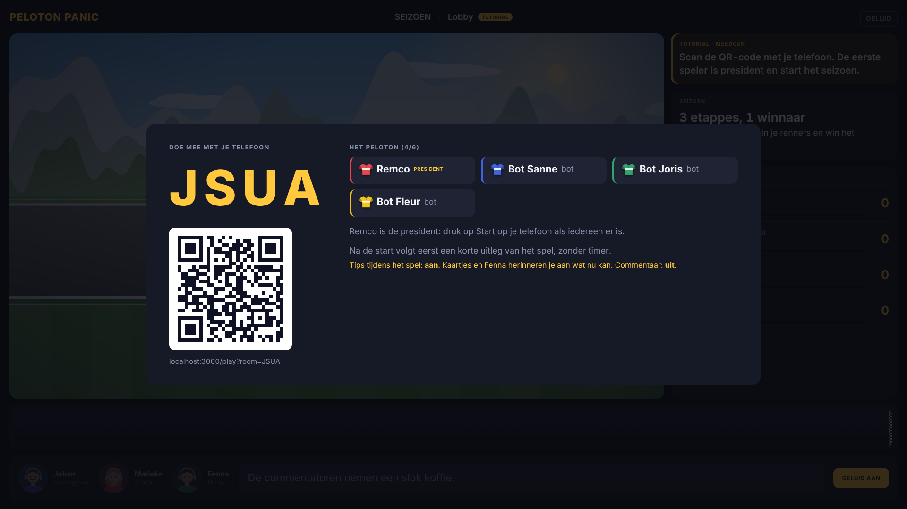
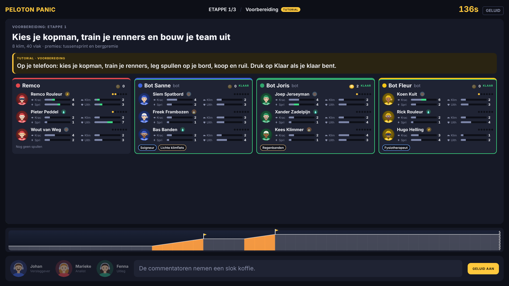
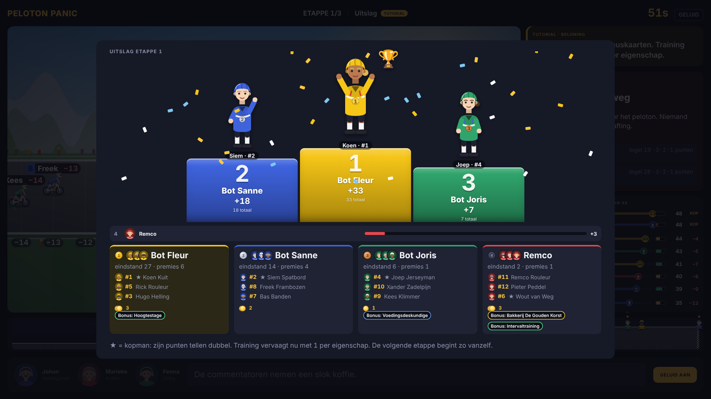
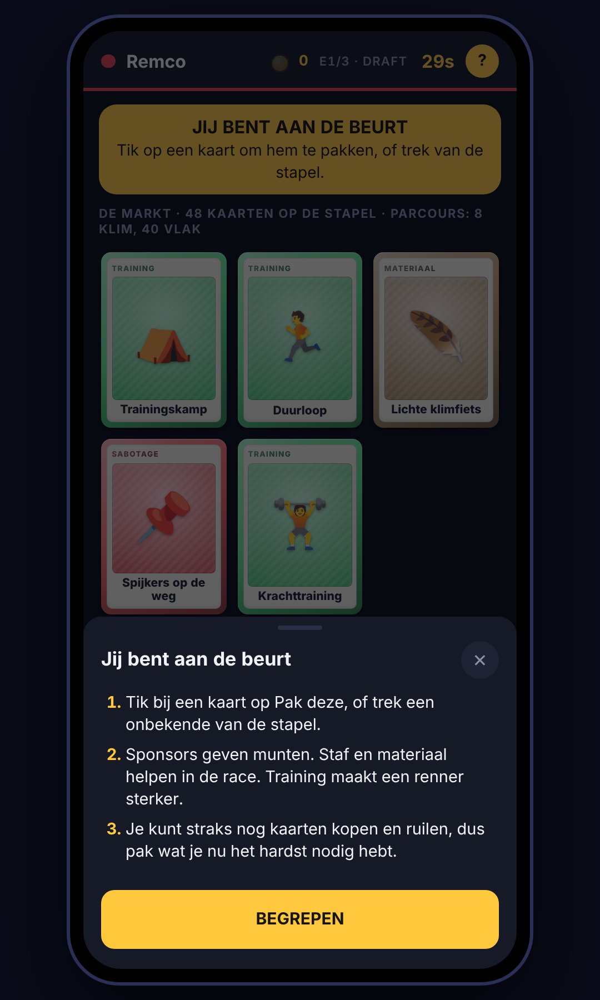
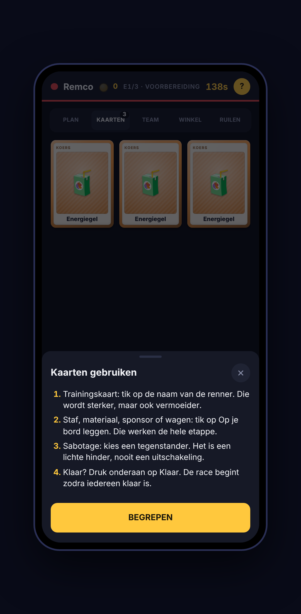
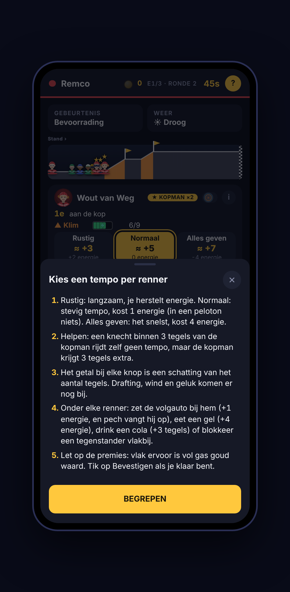

# Peloton Panic

Een bankhangspel voor 2 tot 6 spelers. De tv is het speelbord, jullie telefoons zijn je hand.
Je managet een ploeg van drie renners door een seizoen van drie etappes: eerst je renners
rekruteren, dan kaarten kiezen, renners trainen, spullen en staf inkopen, en een race waarin jouw
voorbereiding, het weer en de groep waarin je rijdt het verschil maken. Wie laatste eindigt, krijgt
de rode lantaarn.



## Starten

```bash
npm install
npm run setup:tts   # optioneel: installeert rany2/edge-tts in ./.venv voor de commentatorstemmen
npm run dev
```

- Tv: open <http://localhost:3000> in de browser van de computer of tv.
- Telefoons: scan de QR-code op de tv, of ga naar het adres onder de kamercode. Telefoons moeten
  op hetzelfde wifi zitten als de computer waarop de server draait.
- De eerste speler die meedoet is de **president**: die start het seizoen, voegt bots toe en kan de
  **tutorial-modus** aanzetten.

## Voor de start: de uitleg

Zodra de president op **Start** drukt, volgt eerst een korte uitleg van het spel, zonder timer.
Zeven pagina's op de tv, gelijk op alle telefoons: het doel, de vier stappen van een etappe, hoe je
punten scoort, energie in de race, de slimme zetten (volgauto, gel, blokkeren), peloton en vallen,
en hoe je bedient. De president bladert
(of slaat over), een commentator leest elke pagina kort voor, en op de laatste pagina tikt
iedereen op *Ik snap het*. Pas daarna begint de draft. De tekst staat in `BRIEFING` in
`src/shared/content.ts`.

## Rekruteren: je eigen ploeg

Na de uitleg kiest iedereen om de beurt **drie renners** uit een gedeelde pool (heen, terug, heen).
De pool is een markt van `teams + 3` kandidaten die steeds wordt aangevuld, met verschillende
types: sprinter, klimmer, rouleur, puncheur en knecht. Elke kandidaat heeft een talentniveau en een
eigenaardigheid:

| Niveau | Prijs | Sterkte |
| --- | --- | --- |
| Neo-prof | gratis | -1 op zijn hoofdeigenschap |
| Vaste waarde | € 1 | standaard |
| Talent | € 2 | +1 op zijn hoofdeigenschap |
| Ster | € 3 | +1 hoofdeigenschap en +1 extra |

Er ligt altijd minstens één gratis renner op de markt. Munten die je hier uitgeeft, heb je later niet
meer voor kaarten.

Daarna geeft iedereen zijn renners een naam (of houdt de willekeurige namen). Daar zit geen timer
op: de draft begint zodra iedereen op **Klaar** drukt. Bots zijn meteen klaar.

## Hoe een etappe werkt

1. **Draft**: op de tv ligt een markt van 5 kaarten. Om de beurt pak je er een, of een onbekende
   van de stapel. Het team onderaan het klassement begint.
2. **Voorbereiding** (telefoon): kijk naar het parcours (klimmen, vlak, kasseien en de premies),
   **kies je kopman**, train je renners, leg spullen op je bord, koop extra kaarten met munten,
   ruil met anderen of saboteer iemand (licht).
3. **Race**: elke ronde kies je per renner **Rustig**, **Normaal** of **Alles geven**. Energie,
   training, staf en materiaal bepalen hoe ver je komt. Een knecht in de buurt van je kopman kan
   in plaats daarvan **Helpen**. Daarnaast bepaal je waar de **volgauto** rijdt en of je een **gel**,
   **cola** of **blokkade** inzet. Peloton, wind, weer, pech en valpartijen doen de rest.
4. **Uitslag**: punten voor de top zes (de slotetappe telt dubbel), munten voor de uitslag en je
   sponsors, bonuskaarten voor het podium en een troostkaart voor de rode lantaarn.

### Waar je invloed zit

| Keuze | Effect |
| --- | --- |
| **Kopman** (voor de race) | Zijn punten voor de eindstand tellen dubbel. De kopmannen worden pas onthuld als de race begint. Kies de renner die bij het parcours past; de Plan-tab laat per renner zien hoe goed dat is. |
| **Helpen** (in de race) | Een knecht binnen 3 tegels van de kopman rijdt zelf geen tempo, maar de kopman krijgt 3 tegels extra per helper (4 bij een echte knecht). |
| **Premies** (onderweg) | Een tussensprint en, als er een klim is, een bergpremie: de eerste drie renners over de lijn scoren 3, 2 en 1 punt. Dat is een reden om vlak ervoor vol gas te geven. |
| **Volgauto** (elke ronde) | Kies bij welke renner de auto rijdt: die krijgt +1 energie en pech bij hem wordt opgevangen. Met een Volgauto-kaart is dat +2 energie en kost een val hem 2 tegels minder. Pech is nu vaak, dus de auto moet echt ergens staan. |
| **Gel** (in de race) | Eén renner krijgt direct +4 energie, dus ook als hij al leeg is en toch vol gas wil. Elke renner krijgt elke etappe een gratis gel. Wanneer je hem eet, is de vraag. |
| **Cola** (in de race) | Eén renner rijdt één ronde +3 tegels extra, zonder energiekosten. Handig vlak voor een premie of de finish. |
| **Blokkade** (in de race) | Een knecht knijpt een tegenstander binnen 3 tegels dicht: die rijdt -2 en krijgt geen drafting. Je kunt dus alleen blokkeren wie bij jouw renners in de buurt rijdt. |
| **Tempo** (elke ronde) | Energie is beperkt en je start niet vol (ca. 60%): vol gas kost 4, normaal 1 (in een peloton niets), rustig geeft er 1 terug (2 in een peloton). Je maximum is `3 + 2 × uithouding`, dus van ca. 7 tot 13. |
| **Peloton** (elke ronde) | Rij je in een groep van 3 of meer, dan rijd je lichter: +1 energie en +2 drafting. Alleen of met z'n tweeën rijden kost 1 energie extra en je krijgt tegenwind. Het peloton jaagt op wie wegrijdt. |
| **Team** (elke ronde) | Teamgenoten in dezelfde groep leveren elk +1 tegel op (max +2). |
| **Training en spullen** | Maken je kopman sneller op precies dit parcours. |

Je keuzes in een ronde (tempo, volgauto, kaarten) worden tegelijk onthuld, dus je weet niet wat de
ander doet. Het toeval zit in pech (ongeveer één op de vijf per renner per ronde, opgevangen door een
reservefiets, mecanicien of de volgauto bij die renner), in valpartijen en in de gebeurtenis van
de ronde.

### Weer en valpartijen

Elke etappe heeft vooraf een weertype: **droog**, **wisselvallig** of **regen**. Bij regen zijn
afdalingen en kasseien de hele etappe glad (-1) en vallen er veel meer renners. Een val gebeurt per
renner per ronde met een kans die oploopt bij nat wegdek, afdalingen, kasseien, Alles geven en een
druk peloton. Wie valt:

- verliest die ronde ca. 5 tegels en 2 energie en wordt 1 vermoeider;
- kan een **zware val** hebben: de volgende etappe is hij -1 op alle eigenschappen, tenzij een
  fysiotherapeut hem er meteen bovenop zet;
- trekt anderen mee: renners binnen één tegel kunnen meevallen (kleiner verlies, geen blessure).

Regenbanden verhalen het natte deel van de kans, een reservefiets of mecanicien dempt de schade.

### Gebeurtenissen

Elke ronde komt er één gebeurtenis bij. Wat er kan gebeuren hangt af van het weer (regen en onweer
alleen als het nat is). Er zijn ruim 25: van tegenwind en bevoorrading tot een kip in een pak, een
pastoor met wijwater en oma met koffie.

### Training en overtraining

Training maakt een renner sterker, maar **vervaagt** na elke etappe met 1 per eigenschap. Elke
training kost vermoeidheid. Is die te hoog, dan ben je **overtraind** en word je juist zwakker. Een
rustdag of fysiotherapeut helpt.

### Spullen

| Soort | Voorbeelden |
| --- | --- |
| Training | Duurloop, Krachttraining, Klimstage, Hoogtestage, Trainingskamp, Rustdag |
| Sponsor | Bakkerij, Regiobank, Energiedrank (munten per etappe) |
| Staf | Mecanicien, Soigneur, Ploegleider, Voedingsdeskundige, Fysio |
| Materiaal | Reservefiets, Aero-wielen, Lichte klimfiets, Regenbanden |
| Wagen | Volgauto, Teambus |
| Koers | Energiegel, Spurtcola, Blokkade: wegwerpkaarten die je tijdens de race inzet (één per renner per ronde) |
| Sabotage | Spijkers op de weg, Verwisselde bidons (altijd een lichte hinder, nooit uitschakeling) |

## Tutorial-modus

De essentie wordt vooraf uitgelegd (zie *Voor de start*). De president kan daarnaast in de lobby
de tutorial aanzetten voor herinneringen tijdens het spel. Er is geen apart spel: iedereen speelt
gewoon mee, tegen elkaar of tegen bots. De tutorial voegt tips toe op drie plekken:

- **Telefoon**: boven elk scherm staat een uitlegkaart die past bij wat je nu doet (je beurt in de
  draft, welk tabblad je open hebt, tempo kiezen). Met *Begrepen* klap je hem dicht, met
  *? Uitleg* haal je hem terug.
- **Tv**: een instructiekaart zegt wat er nu van de spelers wordt verwacht.
- **Fenna**: een Nederlandse stem die in korte blokken aan herinnert wat er kan (draft, kopman
  kiezen, training, ruilen, tempo en helpen, drafting, uitslag), elk onderwerp één keer. Ze noemt
  ook wie er aan de beurt is. Er is meer tijd per fase.

De uitleg staat in `src/shared/tutorial.ts` (telefoon en tv) en `src/shared/commentary.ts`
(commentatoren).

## Commentatoren

Het commentaar staat standaard uit; de president zet het aan in de lobby. Dan vertellen twee
commentatoren (Johan en Marieke) kort vanuit het spelverloop, met Vlaamse stemmen. De tutorial
wordt los daarvan uitgesproken door Fenna, met een Nederlandse stem. De stemmen komen van Microsoft Edge via [edge-tts](https://github.com/rany2/edge-tts), op de server
gegenereerd en gecachet in `.cache/tts`. Zonder edge-tts valt het terug op spraak van de browser en
daarna op ondertitels. Klik één keer op de tv om geluid toe te staan.

Edge TTS is een onofficiële client van een Microsoft-dienst: prima voor een spelletje thuis, maar
niets om een product op te bouwen. Stemmen (Arnaud en Dena, Vlaams; Fenna, Nederlands) staan in `src/shared/content.ts`.

## Geluid

De tv speelt een soundscape die meebeweegt met de scène; de telefoon speelt alleen klikjes en
beurtgeluiden. Alles gaat via WebAudio (`src/client/common/sound.ts`) en wordt aangestuurd door
`src/client/tv/soundtrack.ts`:

| Scène | Geluid |
| --- | --- |
| Lobby, uitleg | ochtendvogels en boerderij |
| Draft | vogels die langzaam naar het bos schuiven |
| Voorbereiding | bos, draaiend wiel, af en toe een moersleutel |
| Race, etappe 1 / 2 / 3 | zee (vlak, kust) / bos (bergen) / boerderij en vogels (platteland), plus peloton en zacht publiek |
| Ronde afhandelen | pedaleren zwelt aan, fiets of auto raast voorbij; regen wordt een stortbui met onweer |
| Ludieke momenten | publiek zwelt op (kip, verkeerde afslag, premie, nieuwe leider), met gejuich |
| Uitslag, eindstand | publiek, fanfare, claxon (alleen bij de eindstand) |

Alle lagen faden in elkaar (een loop kruist ook zichzelf), de commentatoren drukken de ambience
tijdelijk omlaag, en rechtsboven staat een mute-knop. De UI-geluiden en de claxon zijn
gesynthetiseerd, dus daar hoort geen bestand bij.

De samples staan in `src/client/public/audio/`. Ze worden gemaakt met
`python3 scripts/build-audio.py <map met mixkit-wavs> [crowd.wav]` (ffmpeg nodig), dat ze op
gelijke luidheid brengt. De meeste komen van [Mixkit](https://mixkit.co/license/#sfxFree); het
publiek (`crowd.mp3`) is uit een YouTube-video ("Race Crowd Cheering Ambience Sound Effect")
gehaald, controleer de licentie ervan voordat je het spel publiek verspreidt.

## Projectindeling

```
src/shared/   regelmotor (pure reducer), inhoud, commentaar, protocol
src/server/   kamers, WebSocket-server, bots, TTS
src/client/   tv/ (canvas-parcours + panelen), play/ (telefoon) en common/ (kaarten, visuals)
scripts/      setup-tts.sh, screenshots.mts, build-audio.py
```

De regels zijn `(state, action) -> state` in `src/shared/engine.ts`, dus een heel seizoen is
deterministisch vanaf een seed en gedekt door `npm test`.

## Visueel in plaats van tekst

Alles wat je in één oogopslag moet snappen is getekend (SVG en CSS, geen losse plaatjes), in
`src/client/common/visuals.tsx`:

- **Renner-avatars**: elke renner krijgt een eigen gezicht (huid, haar, baard, bril) uit zijn id,
  met helm en shirt in de kleuren van de ploeg. Het type bepaalt de helm: een klimmer draagt een
  koerspetje, een sprinter een aerovizier, een knecht een bril en zweetband.
- **Podium**: in de etappe-uitslag en de eindstand staat de beste renner van elke ploeg
  echt op de 1e, 2e en 3e trede, met medaille, trofee en confetti.
- **Scorebord**: de koers toont avatars die langs de baan schuiven, een kroon voor de leider en een
  energiebatterij per renner. Het klassement toont de ploeg als drie hoofden, munten als stapeltje
  en handkaarten als waaiertje.
- **Parcoursprofiel**: een berglandschap met klimmen, afdalingen en kasseien, de premievlaggen en de
  renners er zelf op.
- **Eigenschappen**: iconen bij elke eigenschap en een vlieger-diagram (radar) op de renner-kaartjes.
- **Overig**: een icoon bij elke gebeurtenis, een type- en eigenaardigheidsbadge per renner, een
  ploegshirt in de lobby.

## Commando's

| Commando | Wat het doet |
| --- | --- |
| `npm run dev` | Server plus Vite op :3000 |
| `npm test` | Tests van de regelmotor |
| `npm run typecheck` | TypeScript-controle |
| `npm run build` / `npm start` | Productiebuild en server |
| `npm run balance` | Simuleert honderden seizoenen met bot-strategieën en toont winkansen, racelengte en de waarde per kaart |
| `npm run screenshots` | Speelt een seizoen met bots en slaat screenshots op in `docs/screenshots` (vereist Google Chrome) |

## Screenshots

| | |
|---|---|
|  |  |
|  |  |

<p>



</p>
